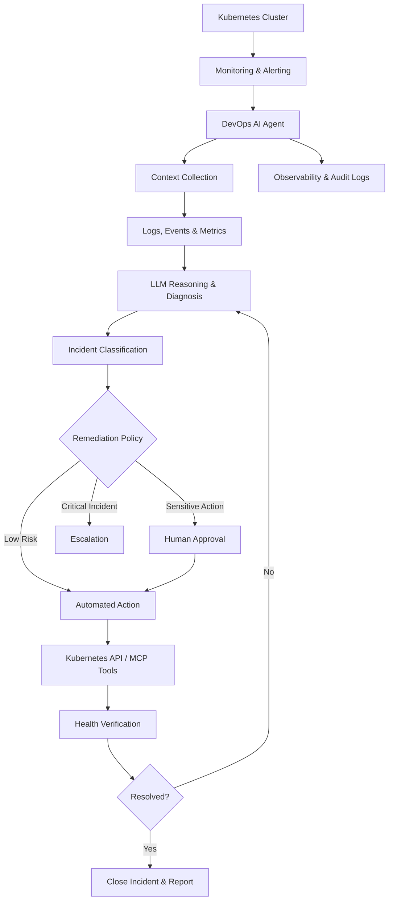

## A Real-World Architecture: Kubernetes Incident Response Agent

Let's consider a practical DevOps scenario.

### Scenario: Automatically Detecting and Resolving Kubernetes Deployment Failures

Imagine a production application running on Kubernetes.

After a new deployment, several pods enter a failing state because of memory exhaustion (`OOMKilled`).

In a traditional workflow, a DevOps engineer would receive an alert, inspect the pods, review logs, identify the root cause, and manually apply a fix.

With an AI-powered DevOps Agent, much of this investigation and remediation workflow can be automated.

### Proposed Architecture



### Step-by-Step Execution

**Step 1 — Detection**

Prometheus detects abnormal memory consumption or Kubernetes reports failing pods.

An alert is generated and sent to the DevOps Agent.

**Step 2 — Context Collection**

The agent retrieves:
- Pod status.
- Kubernetes events.
- Application logs.
- Memory and CPU metrics.
- Recent deployment information.

Tools such as Kubernetes API, Grafana, Prometheus, and MCP integrations can provide this information.

**Step 3 — Root Cause Analysis**

The LLM analyzes the collected information and identifies the likely cause.

Example:

```json
{
  "incident": "production-pod-failure",
  "severity": "P2",
  "root_cause": "OOMKilled",
  "affected_service": "payment-service",
  "recommended_action": "Review memory limits and application usage"
}
```

**Step 4 — Remediation Planning**

The agent generates a structured remediation plan.

Possible actions:
- Inspect memory limits.
- Review recent application changes.
- Restart an unhealthy deployment if policy permits.
- Recommend increasing resource limits.
- Trigger a rollback to the previous stable release.

**Step 5 — Human Approval**

Before executing sensitive operations, the agent presents its proposed actions to the DevOps engineer.

The engineer reviews and approves the operation.

**Step 6 — Execution**

The agent invokes the appropriate tools through Kubernetes API or an MCP server.

**Step 7 — Verification**

The agent checks:
- Pod health.
- Application availability.
- Error rates.
- Resource consumption.

If the problem persists, it returns to the diagnosis stage or escalates the incident.

**Step 8 — Reporting**

The agent generates an incident report containing:
- Root cause.
- Actions performed.
- Execution results.
- Resolution time.
- Recommendations for preventing recurrence.

### Technologies in This Architecture

| Component | Possible Technologies |
|---|---|
| Agent orchestration | LangGraph |
| LLM | OpenAI / Other compatible LLMs |
| Tool integration | MCP |
| Infrastructure | Kubernetes, Docker |
| Monitoring | Prometheus, Grafana |
| Logs | Elasticsearch |
| CI/CD | GitHub Actions, Jenkins |
| Structured validation | Pydantic |
| Human approval | Approval workflow |
| Agent monitoring | AgentOps |

This architecture is illustrative. The actual implementation should enforce permissions and operational policies outside the LLM, rather than allowing the model to execute unrestricted infrastructure commands.
