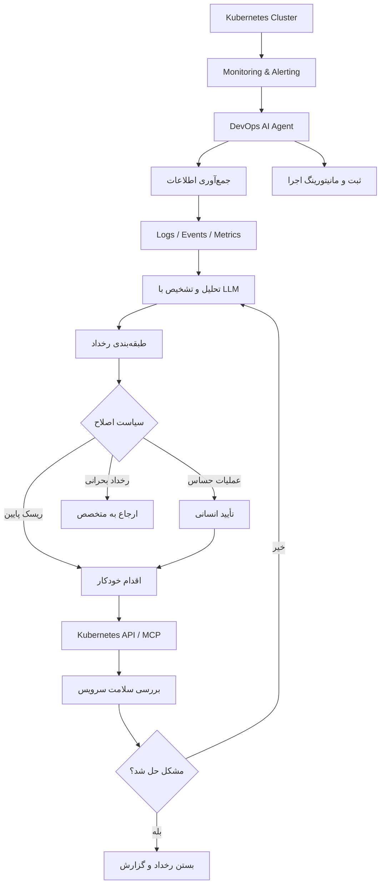

[🇬🇧 English](README.md) | [🇮🇷 فارسی](README.fa.md) 


# 🤖 اتوماسیون DevOps با استفاده از Agentic
### ساخت گردش‌کارهای هوشمند، خودکار و قابل اعتماد با استفاده از AI Agents

## ۱. چرا ایجنت‌های هوش مصنوعی در DevOps اهمیت دارند؟

در روش‌های سنتی، DevOps بر خودکارسازی فرایندهای توسعه نرم‌افزار، استقرار (Deployment)، مدیریت زیرساخت و مانیتورینگ از طریق اسکریپت‌ها، Pipelineها و ابزارهای از پیش تعریف‌شده تمرکز دارد.

اما اتوماسیون سنتی یک محدودیت مهم دارد: معمولاً بر اساس قوانین و گردش‌کارهای از پیش تعیین‌شده عمل می‌کند. زمانی که یک اتفاق غیرمنتظره رخ می‌دهد، اغلب به دخالت انسان برای بررسی مشکل، تشخیص علت ریشه‌ای (Root Cause) و انتخاب راهکار مناسب نیاز است.

اینجاست که **AI Agentها سطح جدیدی از هوشمندی را به اتوماسیون DevOps اضافه می‌کنند.**

برخلاف سیستم‌های اتوماسیون سنتی، ایجنت‌های هوش مصنوعی می‌توانند هدف را درک کنند، با ابزارهای زیرساخت ارتباط برقرار کنند، نتایج اجرا را تحلیل کنند، تصمیم بگیرند و متناسب با شرایط، اقدامات خود را تغییر دهند.

یک سیستم DevOps مبتنی بر AI Agent می‌تواند:

- خطاها و ناهنجاری‌های زیرساخت را شناسایی کند.
- لاگ‌ها، متریک‌ها و رویدادها را برای تشخیص علت خطا تحلیل کند.
- مناسب‌ترین راهکار اصلاحی را انتخاب کند.
- اقدامات اصلاحی تأییدشده را اجرا کند.
- بررسی کند که آیا مشکل واقعاً برطرف شده است یا خیر.
- رخدادهای بحرانی را به مهندسان انسانی ارجاع دهد.

این تحول، DevOps را از اتوماسیون مبتنی بر قوانین ثابت به سمت **اتوماسیون هوشمند، تطبیق‌پذیر و هدف‌محور** حرکت می‌دهد.

### مقایسه اتوماسیون سنتی با اتوماسیون عامل‌محور

| DevOps سنتی | Agentic DevOps |
|---|---|
| اجرای قوانین از پیش تعریف‌شده | تصمیم‌گیری هدف‌محور |
| گردش‌کارهای ثابت | گردش‌کارهای تطبیق‌پذیر |
| اجرای دستورات از طریق اسکریپت | استدلال و استفاده از ابزارها |
| درک محدود از شرایط محیط | تحلیل مبتنی بر زمینه و اطلاعات |
| نیاز به دخالت انسان در شرایط غیرمنتظره | بررسی خودکار همراه با ارجاع به انسان |
| تمرکز بر اجرای عملیات | مشاهده، تحلیل، تصمیم‌گیری، اجرا و اعتبارسنجی |

هدف از ورود AI Agentها حذف مهندسان DevOps نیست؛ بلکه کاهش فعالیت‌های تکراری و کمک به تیم‌های فنی برای تشخیص و رفع سریع‌تر مشکلات است.

---

## ۲. ویژگی‌های اصلی یک DevOps AI Agent

یک ایجنت DevOps صرفاً یک LLM متصل به چند ابزار نیست.

برای ساخت یک سیستم عملیاتی قابل اعتماد، مجموعه‌ای از قابلیت‌ها باید در کنار یکدیگر قرار بگیرند.

### ۱. دریافت اطلاعات و پایش محیط (Perception & Monitoring)

ایجنت باید بتواند اطلاعات محیط عملیاتی خود را دریافت کند.

برای مثال:
- لاگ‌های برنامه‌ها (Application Logs)
- متریک‌های زیرساخت (Infrastructure Metrics)
- رویدادهای Kubernetes
- وضعیت Deploymentها
- بررسی سلامت سرویس‌ها (Health Checks)
- هشدارهای سیستم مانیتورینگ

ابزارهای مرتبط: Prometheus، Grafana، Kubernetes API و Elasticsearch.

### ۲. استدلال و برنامه‌ریزی (Reasoning & Planning)

ایجنت باید اطلاعات جمع‌آوری‌شده را تحلیل کند، علت‌های احتمالی مشکل را شناسایی کند و برای رفع آن برنامه‌ریزی کند.

برای مثال:

فرض کنید یک Deployment در Kubernetes با شکست مواجه شده است.

ایجنت به‌جای اجرای فوری دستور Restart، ابتدا رویدادهای Pod، لاگ‌ها، میزان مصرف منابع و تغییرات اخیر Deployment را بررسی می‌کند.

سپس بر اساس شواهد موجود، یک برنامه اصلاحی پیشنهاد می‌دهد.

### ۳. فراخوانی ابزار و اجرای عملیات (Tool Calling & Execution)

یک ایجنت باید بتواند با سیستم‌ها و ابزارهای خارجی ارتباط برقرار کند.

نمونه عملیات:
- اجرای دستورات Shell
- بررسی منابع Kubernetes
- اجرای دستورات Docker
- فعال‌سازی Pipelineهای CI/CD
- ایجاد یا به‌روزرسانی منابع زیرساخت
- ارتباط با APIهای سرویس‌های ابری

پروتکل MCP (Model Context Protocol) می‌تواند راهی استاندارد برای در اختیار قرار دادن ابزارها و منابع خارجی به ایجنت‌ها فراهم کند.

### ۴. مدیریت وضعیت و حافظه (State Management & Memory)

ایجنت باید بتواند زمینه اجرای فرایند را حفظ کند و بداند در مراحل قبلی چه اتفاقی افتاده است.

برای مثال:
- کدام سرویس دچار مشکل شده است؟
- چه بررسی‌هایی انجام شده‌اند؟
- کدام اقدامات اصلاحی اجرا شده‌اند؟
- آیا اقدام قبلی موفق بوده است؟
- آیا هنوز به تأیید انسان نیاز داریم؟

### ۵. بازخورد و اجرای تکرارشونده (Feedback & Iterative Execution)

یک ایجنت قابل اعتماد نباید فرض کند که اجرای یک دستور به معنی حل شدن مشکل است.

باید نتیجه عملیات را مشاهده کند، آن را ارزیابی کند و در صورت نیاز اقدام دیگری انجام دهد.

چرخه عملیاتی ایجنت به این صورت است:

**مشاهده ← تحلیل ← برنامه‌ریزی ← اجرا ← اعتبارسنجی ← تکرار**

### ۶. دخالت انسان و سازوکارهای کنترلی (Human-in-the-Loop & Guardrails)

قرار نیست تمام عملیات بدون دخالت انسان انجام شوند.

اقداماتی مانند Restart سرویس‌های Production، تغییر زیرساخت، تغییر سطح دسترسی و حذف منابع باید دارای سازوکارهای مناسب تأیید و مجوز باشند.

یک ایجنت عملیاتی باید از قابلیت‌های زیر پشتیبانی کند:

- تأیید عملیات توسط انسان
- کنترل دسترسی مبتنی بر نقش (RBAC)
- محدودیت دسترسی ابزارها
- سیاست‌های اجرایی
- ثبت سوابق عملیات (Audit Logs)
- امکان بازگشت به وضعیت قبلی (Rollback)

### ۷. مشاهده‌پذیری و ردیابی (Observability)

رفتار ایجنت باید قابل مشاهده و ردیابی باشد.

مهندسان باید بتوانند متوجه شوند:

- چرا ایجنت یک تصمیم خاص گرفته است؟
- از چه ابزارهایی استفاده کرده است؟
- چه نتایجی دریافت کرده است؟
- هر اجرا چقدر زمان و هزینه داشته است؟
- گردش کار با موفقیت پایان یافته یا شکست خورده است؟

---

## ۳. یک معماری عملی: ایجنت مدیریت خطاهای Kubernetes

### سناریو: شناسایی و رفع خودکار خطاهای Deployment در Kubernetes

یک سناریوی واقعی از محیط Production را در نظر بگیریم.

فرض کنید یک برنامه روی Kubernetes اجرا می‌شود.

پس از انتشار نسخه جدید، تعدادی از Podها به دلیل کمبود حافظه و خطای `OOMKilled` از کار می‌افتند.

در روش سنتی، مهندس DevOps باید هشدار را دریافت کند، وضعیت Podها را بررسی کند، لاگ‌ها را بخواند، علت مشکل را پیدا کند و به‌صورت دستی راهکار مناسب را اجرا کند.

اما با استفاده از یک DevOps AI Agent می‌توان بخش زیادی از این فرایند بررسی و اصلاح را خودکار کرد.

### معماری پیشنهادی



### مراحل اجرای ایجنت

**مرحله اول: شناسایی خطا (Detection)**

Prometheus افزایش غیرعادی مصرف حافظه را شناسایی می‌کند یا Kubernetes گزارشی از خرابی Podها ارائه می‌دهد.

هشدار ایجادشده برای DevOps Agent ارسال می‌شود.

**مرحله دوم: جمع‌آوری اطلاعات (Context Collection)**

ایجنت اطلاعات زیر را دریافت می‌کند:

- وضعیت Podها
- رویدادهای Kubernetes
- لاگ‌های برنامه
- متریک‌های مصرف CPU و حافظه
- اطلاعات Deploymentهای اخیر

این اطلاعات می‌توانند از طریق Kubernetes API، Grafana، Prometheus و ابزارهای متصل به MCP دریافت شوند.

**مرحله سوم: تشخیص علت ریشه‌ای (Root Cause Analysis)**

LLM اطلاعات جمع‌آوری‌شده را تحلیل می‌کند و علت احتمالی خطا را مشخص می‌کند.

نمونه خروجی:

```json
{
  "incident": "production-pod-failure",
  "severity": "P2",
  "root_cause": "OOMKilled",
  "affected_service": "payment-service",
  "recommended_action": "Review memory limits and application usage"
}
```

**مرحله چهارم: برنامه‌ریزی برای اصلاح (Remediation Planning)**

ایجنت یک برنامه اصلاحی ساختاریافته ایجاد می‌کند.

اقدامات احتمالی:
- بررسی محدودیت حافظه
- بررسی تغییرات اخیر برنامه
- Restart کردن Deployment ناسالم در صورت مجاز بودن
- پیشنهاد افزایش منابع اختصاص‌یافته
- بازگرداندن نسخه قبلی و پایدار برنامه (Rollback)

**مرحله پنجم: تأیید انسانی (Human Approval)**

قبل از اجرای عملیات حساس، ایجنت اقدامات پیشنهادی را به مهندس DevOps نمایش می‌دهد.

مهندس عملیات را بررسی و تأیید می‌کند.

**مرحله ششم: اجرای عملیات (Execution)**

ایجنت ابزار مناسب را از طریق Kubernetes API یا MCP فراخوانی می‌کند.

**مرحله هفتم: اعتبارسنجی (Verification)**

ایجنت موارد زیر را بررسی می‌کند:

- سلامت Podها
- در دسترس بودن برنامه
- نرخ خطا
- میزان مصرف منابع

اگر مشکل همچنان وجود داشته باشد، فرایند به مرحله تشخیص بازمی‌گردد یا به متخصص ارجاع داده می‌شود.

**مرحله هشتم: گزارش‌دهی (Reporting)**

در پایان، گزارشی شامل موارد زیر تولید می‌شود:

- علت ریشه‌ای خطا
- اقدامات انجام‌شده
- نتایج اجرا
- زمان رفع مشکل
- پیشنهادهایی برای جلوگیری از تکرار آن

### فناوری‌های مورد استفاده در این معماری

| بخش | فناوری‌های پیشنهادی |
|---|---|
| مدیریت گردش کار ایجنت | LangGraph |
| مدل زبانی | OpenAI یا سایر LLMهای سازگار |
| اتصال به ابزارها | MCP |
| زیرساخت | Kubernetes، Docker |
| مانیتورینگ | Prometheus، Grafana |
| مدیریت لاگ | Elasticsearch |
| CI/CD | GitHub Actions، Jenkins |
| اعتبارسنجی خروجی | Pydantic |
| تأیید انسانی | Approval Workflow |
| مانیتورینگ ایجنت | AgentOps |

این معماری یک الگوی پیشنهادی است. در پیاده‌سازی واقعی، محدودیت دسترسی و سیاست‌های اجرایی باید مستقل از LLM اعمال شوند و نباید اجازه اجرای نامحدود دستورات زیرساختی به مدل داده شود.

---

## ۴. فریم‌ورک‌های توسعه AI Agent برای اتوماسیون DevOps

فریم‌ورک‌های مختلف، رویکردهای معماری متفاوتی برای توسعه ایجنت‌های هوش مصنوعی ارائه می‌کنند.

برخی بر مدیریت گردش کارهای پیچیده تمرکز دارند، برخی همکاری چندایجنتی را تسهیل می‌کنند و برخی دیگر برای ساخت ایجنت‌های سبک یا نظارت بر عملکرد آن‌ها طراحی شده‌اند.

در ادامه شش ابزار و فریم‌ورک مهم این حوزه را بررسی می‌کنیم.

### ۴.۱. LangGraph؛ مدیریت گردش کارهای پیچیده و مبتنی بر وضعیت

**معماری اصلی: Directed Graph / State Machine**

LangGraph اجرای ایجنت را به شکل یک گراف شامل Node، Edge و State مدل‌سازی می‌کند.

هر Node نماینده یک عملیات است؛ مانند:

- جمع‌آوری اطلاعات مانیتورینگ
- تشخیص رخداد
- تعیین سطح اهمیت خطا
- تولید برنامه اصلاحی
- اجرای عملیات
- بررسی نتیجه

Edgeهای شرطی مشخص می‌کنند که مرحله بعدی کدام باشد.

**ویژگی‌های اصلی:**
- مدیریت وضعیت در گردش کار (State Management)
- تصمیم‌گیری و انشعاب شرطی
- ذخیره و بازیابی وضعیت (Checkpointing)
- توقف اجرا برای تأیید انسان
- کنترل دقیق جریان اجرا
- قابلیت Streaming و Debugging

**کاربردها در DevOps:**
- مدیریت رخدادهای Kubernetes
- بازیابی خودکار Deployment
- تأمین منابع زیرساخت
- عیب‌یابی چندمرحله‌ای
- گردش کارهای اصلاحی مبتنی بر تأیید انسان

**نصب:**

```bash
pip install langgraph
```

GitHub: https://github.com/langchain-ai/langgraph

مستندات: https://docs.langchain.com/oss/python/langgraph/

**چه زمانی از LangGraph استفاده کنیم؟**

زمانی که گردش کار عملیاتی دارای چندین نقطه تصمیم‌گیری، مسیرهای شرطی، تلاش مجدد و مراحل تأیید است، LangGraph کنترل مناسبی بر اجرای فرایند فراهم می‌کند.

---

### ۴.۲. CrewAI؛ همکاری چند ایجنت تخصصی

**معماری اصلی: Role-based Multi-Agent Collaboration**

CrewAI امکان تعریف چند ایجنت تخصصی و همکاری آن‌ها در قالب یک تیم را فراهم می‌کند.

هر ایجنت دارای مشخصات زیر است:

- Role: نقش
- Goal: هدف
- Backstory: پیش‌زمینه
- Tools: ابزارها
- Tasks: وظایف

CrewAI از چند روش اجرای وظایف پشتیبانی می‌کند:

- Sequential: اجرای وظایف به‌صورت ترتیبی
- Hierarchical: مدیریت و تقسیم وظایف توسط یک ایجنت مدیر
- Parallel: اجرای هم‌زمان وظایف مستقل

**ویژگی‌های اصلی:**
- تعریف ایجنت‌های مبتنی بر نقش
- مدیریت وظایف
- واگذاری وظایف بین ایجنت‌ها
- همکاری چندایجنتی
- اتصال به ابزارهای خارجی
- هماهنگ‌سازی گردش کار

**کاربردها در DevOps:**
- ممیزی امنیتی زیرساخت
- بررسی وضعیت سرویس‌ها
- بهینه‌سازی هزینه‌های Cloud
- بررسی انطباق با استانداردها
- تولید گزارش‌های عملیاتی زمان‌بندی‌شده

**نصب:**

```bash
pip install crewai crewai-tools
```

GitHub: https://github.com/crewAIInc/crewAI

مستندات: https://docs.crewai.com/

**چه زمانی از CrewAI استفاده کنیم؟**

زمانی که برای بررسی یک مسئله به چند تخصص مختلف نیاز داریم؛ برای مثال تحلیل هم‌زمان امنیت، پایداری و هزینه زیرساخت.

---

### ۴.۳. Agno؛ توسعه سریع و سبک ایجنت‌ها

**معماری اصلی: Lightweight Agents / Agent Teams**

Agno بر ساخت ایجنت‌ها با کدنویسی کمتر و معماری سبک تمرکز دارد.

این فریم‌ورک ابزارها، حافظه، قابلیت‌های استدلال و پشتیبانی از ورودی‌های چندرسانه‌ای را ارائه می‌کند.

**ویژگی‌های اصلی:**
- تعریف ساده ایجنت
- ابزارهای آماده
- پشتیبانی از حافظه و دانش
- قابلیت ساخت تیم‌های ایجنتی
- پشتیبانی از ورودی‌های چندرسانه‌ای
- امکانات استقرار و ارائه سرویس

برخی ابزارهای آماده آن عبارت‌اند از:

- Shell Tools
- Docker Tools
- GitHub Tools
- SQL Tools
- File Tools

**کاربردها در DevOps:**
- ساخت ایجنت‌های سبک مانیتورینگ
- مدیریت Docker
- خودکارسازی عملیات GitHub
- دستیار اجرای دستورات Shell
- ساخت سریع ایجنت‌های عملیاتی

**نصب:**

```bash
pip install agno
```

GitHub: https://github.com/agno-agi/agno

مستندات: https://docs.agno.com/

**چه زمانی از Agno استفاده کنیم؟**

زمانی که به یک ایجنت سبک با قابلیت اتصال به ابزارها نیاز داریم و می‌خواهیم پیچیدگی فریم‌ورک را به حداقل برسانیم.

---

### ۴.۴. AutoGen / AG2؛ سیستم‌های چندایجنتی مبتنی بر گفت‌وگو

**معماری اصلی: Conversational Multi-Agent System**

AutoGen فریم‌ورکی چندایجنتی است که توسعه آن از Microsoft Research آغاز شد.

AG2 یک ادامه مستقل و جامعه‌محور از پروژه AutoGen است.

این رویکرد به ایجنت‌ها اجازه می‌دهد از طریق پیام با یکدیگر ارتباط برقرار کنند، اطلاعات ردوبدل کنند، ابزارها را اجرا کنند و در حل مسائل همکاری داشته باشند.

**ویژگی‌های اصلی:**
- گفت‌وگوی چندایجنتی
- اجرای ابزارها
- تولید و اجرای کد
- حلقه بازخورد و اصلاح
- همکاری بین ایجنت‌ها
- مشارکت انسان در گردش کار

**کاربردها در DevOps:**
- تولید تنظیمات Terraform
- تحلیل لاگ‌های زیرساخت
- تولید و اعتبارسنجی اسکریپت‌های Deployment
- بازبینی تغییرات زیرساخت
- تحلیل گروهی رخدادها

**نصب AG2:**

```bash
pip install ag2
```

GitHub: https://github.com/ag2ai/ag2

مستندات: https://docs.ag2.ai/

**چه زمانی از AutoGen / AG2 استفاده کنیم؟**

زمانی که یک مسئله نیازمند گفت‌وگو میان ایجنت‌ها، بررسی راهکارهای مختلف، تولید کد، اجرای آن و اصلاح نتیجه بر اساس بازخورد است.

---

### ۴.۵. OpenAI Agents SDK؛ ایجنت‌های ابزارمحور و واگذاری وظایف

**معماری اصلی: Agent Loop / Tools / Handoffs**

OpenAI Agents SDK مجموعه‌ای از اجزای ساده برای ساخت ایجنت‌های ابزارمحور و هماهنگ‌سازی ایجنت‌های تخصصی ارائه می‌کند.

اجزای اصلی:

- Agent: تعریف دستورالعمل‌ها، مدل و ابزارها
- Runner: اجرای چرخه ایجنت
- Tools: ارتباط با سیستم‌های خارجی
- Handoffs: انتقال وظیفه به ایجنت تخصصی
- Guardrails: اعتبارسنجی ورودی و خروجی
- Tracing: ردیابی اجرای ایجنت

**مثال:**

یک Triage Agent در سیستم DevOps یک مشکل مرتبط با دیتابیس را شناسایی می‌کند و وظیفه را به Database Specialist Agent منتقل می‌کند.

ایجنت تخصصی با استفاده از ابزارهای مانیتورینگ دیتابیس، مشکل را بررسی کرده و نتیجه را بازمی‌گرداند.

**ویژگی‌های اصلی:**
- توسعه ساده ایجنت
- فراخوانی Function و ابزارهای خارجی
- انتقال وظایف بین ایجنت‌ها
- کنترل ورودی و خروجی
- قابلیت Tracing
- هماهنگی بین ایجنت‌های تخصصی

**کاربردها در DevOps:**
- تشخیص اولیه رخدادها
- ساخت ایجنت‌های تخصصی زیرساخت
- دستیارهای Deployment
- اتوماسیون مبتنی بر ابزار
- واگذاری وظایف

**نصب:**

```bash
pip install openai-agents
```

GitHub: https://github.com/openai/openai-agents-python

مستندات: https://openai.github.io/openai-agents-python/

**چه زمانی از OpenAI Agents SDK استفاده کنیم؟**

زمانی که به معماری نسبتاً ساده‌ای برای ساخت ایجنت‌های ابزارمحور با قابلیت واگذاری وظیفه، Guardrails و ردیابی اجرای ایجنت نیاز داریم.

---

### ۴.۶. AgentOps؛ مشاهده‌پذیری و مانیتورینگ ایجنت‌ها

**دسته‌بندی: Agent Observability / Monitoring**

AgentOps با فریم‌ورک‌های قبلی تفاوت اساسی دارد.

این ابزار در درجه اول برای مدیریت گردش کار ایجنت‌ها طراحی نشده است؛ بلکه بر مشاهده، ردیابی و تحلیل نحوه اجرای آن‌ها تمرکز دارد.

در یک محیط عملیاتی، دانستن اینکه ایجنت چه کاری انجام می‌دهد به اندازه دانستن اینکه آیا موفق شده است اهمیت دارد.

**ویژگی‌های اصلی:**
- ردیابی فراخوانی‌های LLM
- مانیتورینگ اجرای ابزارها
- بررسی مصرف توکن و هزینه
- اندازه‌گیری تأخیر
- ثبت خطاها
- بازبینی تاریخچه اجرا
- تحلیل عملکرد ایجنت

**کاربردها در DevOps:**
- مانیتورینگ ایجنت‌های Production
- اشکال‌زدایی گردش کارها
- کنترل هزینه‌های عملیاتی
- اندازه‌گیری نرخ موفقیت و شکست
- بهبود قابلیت اطمینان ایجنت‌ها

**نصب:**

```bash
pip install agentops
```

GitHub: https://github.com/AgentOps-AI/agentops

مستندات: https://docs.agentops.ai/

**چه زمانی از AgentOps استفاده کنیم؟**

زمانی که ایجنت‌ها در محیط عملیاتی مستقر شده‌اند و به مشاهده رفتار، شناسایی خطاها و کنترل هزینه‌های اجرای آن‌ها نیاز داریم.

---

## ۵. مقایسه معماری فریم‌ورک‌ها؛ تفاوت اصلی آن‌ها چیست؟

تفاوت اصلی این فریم‌ورک‌ها صرفاً در تعداد قابلیت‌ها یا ابزارهای قابل اتصال نیست.

تفاوت مهم‌تر در نحوه مدل‌سازی اجرای ایجنت، هماهنگی بین آن‌ها و کنترل جریان عملیات است.

### مقایسه ساختاری

| فریم‌ورک | مدل معماری | تمرکز اصلی | نحوه کنترل اجرا |
|---|---|---|---|
| LangGraph | گراف و ماشین حالت | گردش کارهای پیچیده | Node و Edge شرطی |
| CrewAI | سیستم چندایجنتی مبتنی بر نقش | تقسیم وظایف و همکاری | فرایندهای Crew |
| Agno | ایجنت سبک و تیم ایجنتی | سادگی و سرعت توسعه | اجرای Agent و Team |
| AutoGen / AG2 | سیستم چندایجنتی مکالمه‌محور | ارتباط و تعامل ایجنت‌ها | مبتنی بر مکالمه |
| OpenAI Agents SDK | چرخه ایجنت و Handoff | استفاده از ابزار و واگذاری وظیفه | Runner و Handoff |
| AgentOps | لایه مشاهده‌پذیری | مانیتورینگ و اشکال‌زدایی | ردیابی اجرا |

### بررسی تفاوت‌های معماری

**۱. معماری مبتنی بر گراف (LangGraph)**

جریان اجرای سیستم به‌صورت یک گراف مشخص تعریف می‌شود.

توسعه‌دهنده کنترل می‌کند:
- کدام عملیات اجرا شود.
- چه شرطی مسیر بعدی را تعیین کند.
- اجرای سیستم در کجا متوقف شود.
- وضعیت چگونه ذخیره و بازیابی شود.

این معماری برای گردش کارهای عملیاتی پیچیده که مسیر اجرای آن‌ها باید قابل پیش‌بینی و بررسی باشد، مناسب است.

**۲. معماری مبتنی بر نقش (CrewAI)**

سیستم بر اساس ایجنت‌های تخصصی طراحی می‌شود.

هر ایجنت مسئولیت مشخصی دارد و وظایف تعریف‌شده‌ای را انجام می‌دهد.

این مدل برای مسائلی مناسب است که به چند دیدگاه تخصصی نیاز دارند؛ مانند تحلیل امنیت، پایداری و هزینه.

**۳. معماری سبک ایجنتی (Agno)**

تمرکز بر ساخت سریع ایجنت‌ها با حداقل پیچیدگی و استفاده از ابزارهای آماده است.

این مدل برای پروژه‌هایی که سادگی، سرعت توسعه و اجرای سبک اهمیت دارد، مناسب است.

**۴. معماری مکالمه‌محور (AutoGen / AG2)**

ایجنت‌ها از طریق پیام با یکدیگر ارتباط برقرار می‌کنند.

این مدل زمانی مفید است که یک مسئله به گفت‌وگو، تولید کد، اجرا، بررسی نتیجه و اصلاح مکرر نیاز داشته باشد.

**۵. معماری چرخه ایجنت و واگذاری وظیفه (OpenAI Agents SDK)**

یک ایجنت چرخه استدلال و استفاده از ابزار را اجرا می‌کند و می‌تواند در صورت نیاز وظیفه را از طریق Handoff به ایجنت تخصصی دیگری منتقل کند.

این روش برای ساخت سیستم‌هایی با مسئولیت‌های مشخص و جداشده مناسب است.

**۶. معماری مشاهده‌پذیری (AgentOps)**

به‌جای تعیین نحوه همکاری یا تصمیم‌گیری ایجنت‌ها، بر قابل مشاهده کردن اجرای آن‌ها تمرکز دارد.

بنابراین AgentOps مکمل فریم‌ورک‌های ساخت ایجنت است، نه جایگزین آن‌ها.

---

## ۶. کدام فریم‌ورک برای DevOps مناسب‌تر است؟

هیچ فریم‌ورکی برای تمام پروژه‌ها بهترین انتخاب نیست.

انتخاب مناسب به مسئله عملیاتی و معماری موردنیاز بستگی دارد.

| نیاز پروژه | گزینه پیشنهادی |
|---|---|
| مدیریت رخدادهای پیچیده | LangGraph |
| همکاری چند ایجنت تخصصی | CrewAI |
| ساخت ایجنت‌های سبک و ابزارمحور | Agno |
| تولید و اجرای مشارکتی کد | AutoGen / AG2 |
| واگذاری وظایف بین ایجنت‌ها | OpenAI Agents SDK |
| مانیتورینگ و ردیابی ایجنت‌ها | AgentOps |

### آیا می‌توان از چند فریم‌ورک در یک سیستم استفاده کرد؟

بله.

این فریم‌ورک‌ها لزوماً رقیب مستقیم یکدیگر نیستند و می‌توانند قابلیت‌های مکملی در یک معماری بزرگ‌تر داشته باشند.

برای مثال:

```text
              سیستم DevOps مبتنی بر AI
                         |
                     LangGraph
                   Orchestration
                         |
           +-------------+-------------+
           |             |             |
           v             v             v
        Agno Agent    CrewAI Team   OpenAI Agent
           |             |             |
           +-------------+-------------+
                         |
                      MCP Tools
                         |
           +-------------+-------------+
           |             |             |
        Kubernetes     Docker      Monitoring
                         |
                         v
                   Human Approval
                         |
                         v
                   Tool Execution
                         |
                         v
                     Verification
                         |
                         v
                      AgentOps
                    Observability
```

این فقط یک معماری مفهومی است و الزامی نیست که همه فریم‌ورک‌ها را با هم ترکیب کنیم.

در پیاده‌سازی واقعی بهتر است مسئولیت هماهنگ‌سازی گردش کار مشخص باشد تا پیچیدگی غیرضروری به سیستم تحمیل نشود.

---

## ۷. ملاحظات Production؛ از ایجنت آزمایشی تا اتوماسیون قابل اعتماد

ساخت ایجنتی که بتواند یک دستور را اجرا کند، کار نسبتاً ساده‌ای است.

اما ساخت ایجنتی که بتواند با امنیت و قابلیت اطمینان در زیرساخت Production فعالیت کند، چالش مهندسی بسیار بزرگ‌تری است.

یک DevOps Agent عملیاتی باید موارد زیر را پوشش دهد:

- **Security:** محدود کردن دسترسی به منابع زیرساخت و اطلاعات حساس.
- **Permissions:** استفاده از حداقل سطح دسترسی لازم (Least Privilege).
- **Human Approval:** دریافت تأیید برای عملیات حساس و پرریسک.
- **Isolation:** اجرای کدهای تولیدشده در محیط‌های ایزوله و محدود.
- **Reliability:** مدیریت تلاش مجدد، Timeout و شکست عملیات.
- **Observability:** ثبت فراخوانی ابزارها، تصمیم‌ها، هزینه‌ها و نتایج.
- **Recovery:** فراهم کردن امکان Rollback و ارجاع رخداد.
- **Validation:** بررسی وضعیت واقعی سیستم پس از هر عملیات مهم.

اصل مهم:

**صرفاً به این دلیل که یک ایجنت می‌تواند درباره یک عملیات استدلال کند، نباید اجرای آن عملیات را بدون محدودیت به او واگذار کرد.**

اقدامات ایجنت باید محدود، اعتبارسنجی، مجاز و پس از اجرا بررسی شوند.

---

## ۸. جمع‌بندی

Agentic AI رویکرد جدیدی به اتوماسیون DevOps معرفی می‌کند.

در حالی که اتوماسیون سنتی گردش‌کارهای از پیش تعریف‌شده را اجرا می‌کند، ایجنت‌های هوش مصنوعی می‌توانند شرایط عملیاتی را تحلیل کنند، تصمیم بگیرند، از ابزارها استفاده کنند و بر اساس بازخورد، مسیر اجرای خود را تغییر دهند.

اما انتخاب فریم‌ورک مناسب نیازمند شناخت معماری و نحوه عملکرد آن است.

- LangGraph کنترل دقیق گردش کارهای پیچیده را فراهم می‌کند.
- CrewAI همکاری بین ایجنت‌های تخصصی را سازمان‌دهی می‌کند.
- Agno توسعه سریع ایجنت‌های سبک را تسهیل می‌کند.
- AutoGen / AG2 امکان همکاری مکالمه‌محور بین ایجنت‌ها را فراهم می‌کنند.
- OpenAI Agents SDK ابزارها، Handoff و Guardrails را در اختیار توسعه‌دهندگان قرار می‌دهد.
- AgentOps اجرای ایجنت‌ها را قابل مشاهده و اندازه‌گیری می‌کند.

چالش اصلی صرفاً ساخت یک ایجنت خودکار نیست؛ بلکه مهندسی یک سیستم عملیاتی هوشمند است که **قابل اعتماد، امن، قابل مشاهده و محدود به چارچوب‌های اجرایی مشخص** باشد.

---

## 📚 منابع و مخازن رسمی

| فریم‌ورک | مخزن GitHub |
|---|---|
| LangGraph | https://github.com/langchain-ai/langgraph |
| CrewAI | https://github.com/crewAIInc/crewAI |
| Agno | https://github.com/agno-agi/agno |
| AG2 | https://github.com/ag2ai/ag2 |
| OpenAI Agents SDK | https://github.com/openai/openai-agents-python |
| AgentOps | https://github.com/AgentOps-AI/agentops |

### فناوری‌های مرتبط

- Kubernetes: https://github.com/kubernetes/kubernetes
- Docker: https://github.com/docker
- MCP: https://github.com/modelcontextprotocol
- Prometheus: https://github.com/prometheus/prometheus
- Grafana: https://github.com/grafana/grafana

---

*این بخش بخشی از مسیر یادگیری و بررسی کاربردهای عملی Agentic AI، اتوماسیون هوشمند و مهندسی سیستم‌های مبتنی بر هوش مصنوعی است. در ادامه، معماری‌های بیشتر، مثال‌های کدنویسی و پیاده‌سازی‌های عملی به این مجموعه اضافه خواهند شد.*
